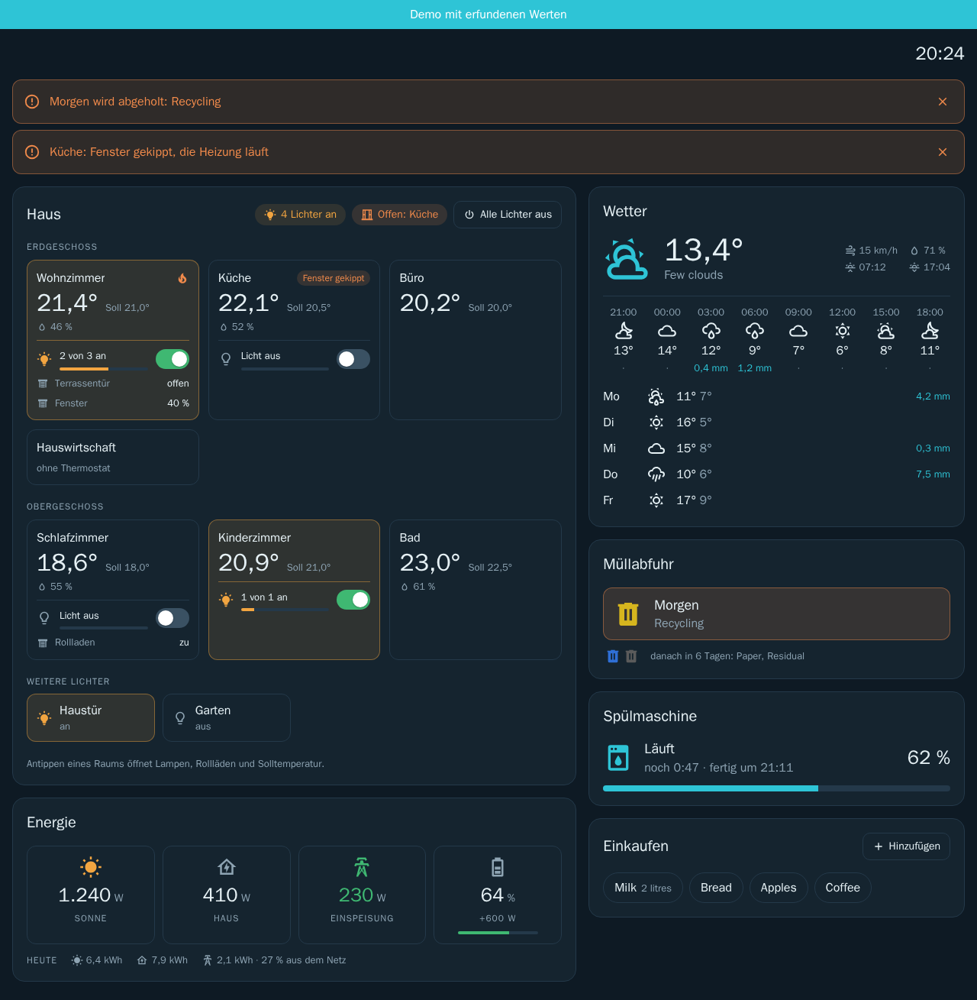

# CleanDash for ioBroker

**A clean, ready-made dashboard for wall tablets.** Pick your datapoints in the ioBroker admin, open the page on a
tablet, done. No widgets to draw, no CSS to write: CleanDash looks tidy out of the box, in light and dark.

> **Status: early draft (0.2.0).** Rooms and lights, weather, energy, waste collection, dishwasher and shopping list work; more tiles follow. Not yet in the ioBroker
> repository. Feedback welcome.



## What it does

- **Rooms by floor:** temperature, setpoint, humidity, heating, window state, shutters, the room's lights with one switch
- **Room details:** every lamp with switch and dimmer, shutters with slider, setpoint in 0.5 ° steps
- **Lamps made of several devices** (for example eight LED strips) switch and dim together
- **Weather** (openweathermap adapter): now, the next 24 hours, the coming days
- **Energy** from any datapoints: solar, house, grid draw or feed-in, battery, today's totals
- **Waste collection** (trashschedule adapter) in the colours you set up there
- **Dishwasher** (homeconnect adapter): time left, end time, progress
- **Shopping lists** (bring adapter): tap an item to take it off, add with recently bought items as suggestions
- **Notices at the top:** things that need attention appear as a banner, for example bin day tomorrow, a window open
  while the heating runs, a finished dishwasher, or lamps that are not reachable
- **Asks before switching**, always or only for several devices at once (your choice)
- **Light and dark** automatically by sunrise and sunset at the location from the ioBroker system settings
- **English and German**, following the ioBroker system language
- **Live:** values arrive the moment they change (socket of the web adapter, no polling)
- **Your login, your rights:** the page connects through the ioBroker web adapter, so its authentication and user
  permissions apply. No cloud, nothing leaves your network.

## Installation

Until CleanDash is in the ioBroker repository, install it from GitHub: in the admin, *Adapters* → the GitHub icon →
*Custom* → `https://github.com/supremedk1985/CleanDash`. Then add an instance.

Requirements: ioBroker with js-controller 6 or newer, admin 7, and the **web** adapter.

## Setup

Open the instance settings:

| Tab | One row per … | Notes |
|---|---|---|
| **General** | – | Title, when to ask before switching, light/dark |
| **Rooms** | room | Name, floor, and any of: temperature, setpoint, humidity, heating (valve or on/off), window. Leave out what the room does not have. Window value: contact (`true` = open), handle (`0` closed, `1` tilted, `2` open) or text (`OPEN`, `TILTED`, `CLOSED`) |
| **Lights** | device | Name, room, on/off datapoint, optionally brightness (with its maximum, for example `255` for WLED) and reachable. Rows with the same name and room become one lamp. A room that is not in the room list shows the lamp under *More lights* |
| **Shutters** | shutter | Room, name, position datapoint, value range and whether the highest value or 0 means fully closed |
| **Weather, waste, dishwasher** | – | The openweathermap and trashschedule instance, the Home Connect device |
| **Energy** | – | Any of: solar, consumption, grid import and export (W), battery level (%), charging and discharging (W), today's kWh |
| **Shopping lists** | Bring! list | Name and the list's `content` datapoint |

Then open `http://<ioBroker>:8082/cleandash/index.html` (the link is also on the instance in the admin). A second
instance is opened with `?instance=1`.

## Try it without ioBroker

```sh
npm install
npm run dev        # opens the demo house with made-up values
```

`index.html?demo` shows the demo house inside ioBroker as well.

## Development

```sh
npm test           # unit tests (vitest)
npm run build      # type check and build into www/
npm pack           # adapter package for a test installation
```

The page lives in `src-www/` (Vue 3, Vite, TypeScript, no UI framework). Everything a tile shows comes from the
instance configuration; no datapoint is written into the code. Raw values are interpreted in
`src-www/lib/values.ts`, which is where adapter quirks belong, each with a test.

## Roadmap

1. Rooms and lights ✔
2. Weather, energy, waste collection, dishwasher, shopping list ✔
3. Tiles for well-known adapters (robot mower, vacuum, Bring!, speed test, OctoPrint, Paperless)
4. Speed test measured by the adapter itself, rated against your own average
5. Edit mode on the dashboard: drag tiles, protected by a PIN, layout stored in ioBroker

## License

MIT © 2026 Daniel Korte. Icons: [Material Design Icons](https://pictogrammers.com/library/mdi/) (Apache 2.0).

---

## Deutsch

**Aufgeräumtes, fertiges Dashboard für Wandtablets.** Datenpunkte im ioBroker-Admin auswählen, Seite auf dem Tablet
öffnen, fertig. Hell und dunkel, Deutsch und Englisch, mit Rückfrage vor dem Schalten und Meldungen als Banner oben.

**Stand:** früher Entwurf (0.2.0) mit Kacheln für Räume und Licht, Wetter, Energie, Müllabfuhr, Spülmaschine und Einkaufsliste. Installation vorerst über GitHub (Admin →
Adapter → GitHub-Symbol → *Benutzerdefiniert* → `https://github.com/supremedk1985/CleanDash`), Voraussetzung ist der
**web**-Adapter. Eingerichtet wird in den Instanzeinstellungen (Räume, Licht, Rollläden, Wetter, Müll, Spülmaschine, Energie, Einkaufslisten), danach
`http://<ioBroker>:8082/cleandash/index.html` öffnen.
