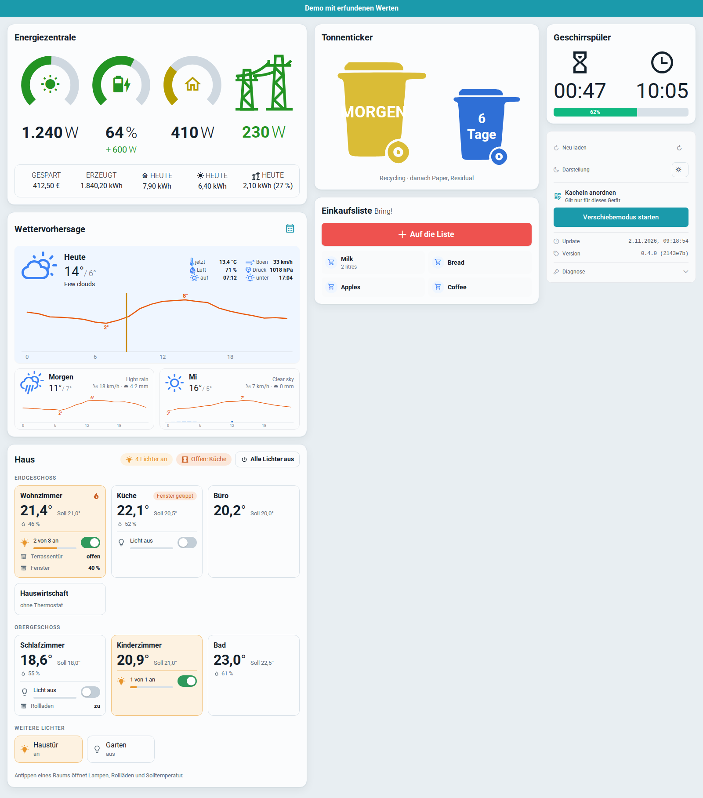
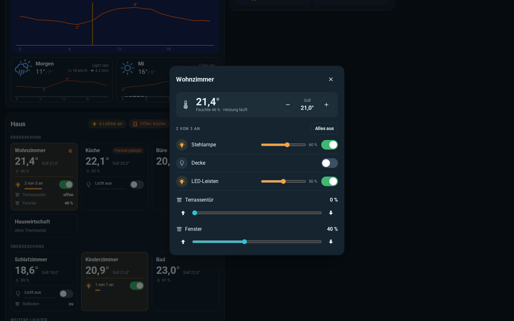
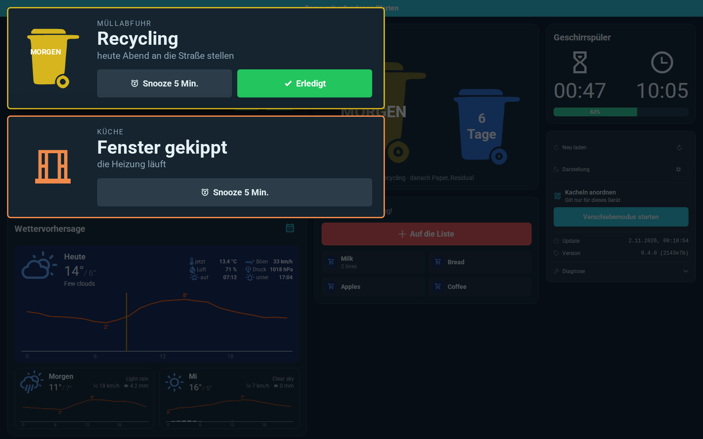
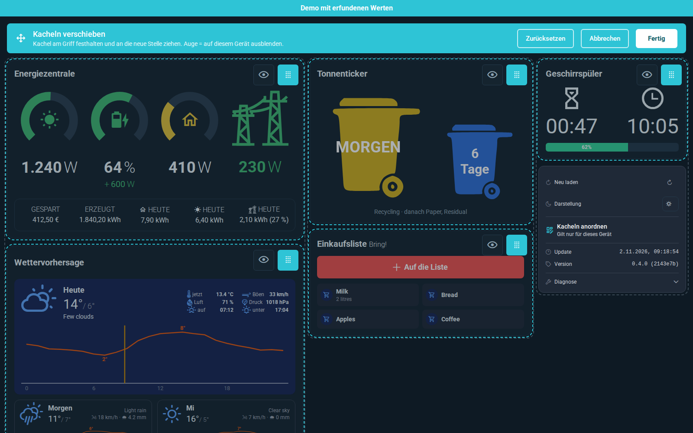

# CleanDash for ioBroker

**A clean, ready-made dashboard for wall tablets.** Pick your datapoints in the ioBroker admin, open the page on a
tablet, done. No widgets to draw, no CSS to write: CleanDash looks tidy out of the box, in light and dark.

> **Status: early version (0.4.0).** [German quick guide](docs/de/README.md). All tiles below work; not yet in the ioBroker repository. Feedback welcome.


| Light | A room | Notices | Move mode |
|---|---|---|---|
|  |  |  |  |

## What it does

Every tile appears only when it is set up in the instance settings. Nothing about your house is written into the code:
devices, instances and addresses all come from the settings.

| Tile | Source | What you see and can do |
|---|---|---|
| **Rooms by floor** | any datapoints | Temperature, setpoint, humidity, heating, window, shutters, the room's lights with one switch. Tap a room for every lamp with dimmer, shutters with slider, setpoint in 0.5 ° steps. Lamps made of several devices switch together |
| **Energy** | any datapoints | Solar, battery, house, grid as rings in traffic-light colours, today's totals, money saved. Optional history (day/week/month/year) from files, see [docs/energy-history.md](docs/energy-history.md) |
| **Weather** | openweathermap adapter (+ optional Open-Meteo) | Today, tomorrow, the day after, a rain and temperature timeline per hour, details for the week |
| **Waste collection** | trashschedule adapter | The next two bins in the colours set up there |
| **Dishwasher** | homeconnect adapter | Time left, end time, progress |
| **Shopping lists** | bring adapter | Tap an item to take it off, add items with suggestions |
| **Robot mower** | navimow adapter | Map with dock and live position, start, pause, resume, send home |
| **Robot vacuum** | roborock adapter | State, battery, area, station (water tanks, dust bag, filter), start and dock |
| **3D printer** | octoprint adapter | Progress, time left, temperatures, optional webcam picture |
| **Fuel prices** | tankerkoenig adapter | Your stations, cheapest first |
| **Dehumidifier** | sonoff adapter (Tasmota plug) | On/off, power, energy today; the 24-hour and 7-day history needs the history adapter logging `POWER` and `ENERGY_Power` |
| **Call button** | any boolean datapoint | One big button that sets it to `true` (for example a doorbell for the kids' rooms) |
| **Documents in the inbox** | any number datapoint | The count, for example from a Paperless script |
| **Internet speed** | JSON file | Download, upload, ping from a measuring script of your own, rated against your own average ([format](#data-formats)) |
| **Fireplace** | a folder with datapoints | Pixel campfire that burns as strongly as the stove, flue temperature, “add wood” — the tile appears only while the fire burns ([format](#data-formats)) |
| **Second robot via script** | a folder with three datapoints | For robots the adapter cannot read: a script of your own writes the state, CleanDash reminds you to start the self-cleaning ([format](#data-formats)) |
| **Fundus** | own server (address) | Search the parts box of [Fundus](https://github.com/supremedk1985/Fundus), a self-hosted app by the author; only if you run it |
| **MachIchGleich** | own server (address) | Tasks from the author's private task app; it is not published, so leave this empty |

**Notices** that need attention lie over the page on the left; the tiles do not move. Each can be snoozed for five
minutes, and those that are a task can be marked done (it comes back next time the cause appears):
bin day today or tomorrow, a window open while the heating runs, the dishwasher finished, paused or with an error,
the mower stuck or lifted, the vacuum station needing water, emptying or a filter.

**Arrange the tiles per device:** in the tile *Info & diagnostics*, *Start move mode*. Drag a tile by its handle to
another place or column, or hide it with the eye; *Done* saves the order in this browser, so the kitchen tablet and a
phone can each have their own. *Reset* brings back the default order.

Also: **asks before switching** (always or only for several devices at once), **light and dark** by sunrise and
sunset at the location from the ioBroker system settings, **English and German** for rooms, energy, waste, notices and
move mode (the weather details and the other tiles are German for now), and **your login, your rights**: the page connects through the ioBroker
web adapter, so its authentication and user permissions apply. No cloud, nothing leaves your network except the
optional Open-Meteo forecast.

## Installation

Until CleanDash is in the ioBroker repository, install it from GitHub: in the admin, *Adapters* → the GitHub icon →
*Custom* → `https://github.com/supremedk1985/CleanDash`. Then add an instance.

Requirements: ioBroker with js-controller 6 or newer, admin 7, and the **web** adapter.

## Setup

Open the instance settings:

| Tab | One row per … | Notes |
|---|---|---|
| **General** | – | Title, when to ask before switching, light/dark |
| **Rooms** | room | Name, floor, and any of: temperature, setpoint, humidity, heating (valve or on/off), window. Leave out what the room does not have. Window value: contact (`true` = open), handle (`0` closed, `1` tilted, `2` open) or text (`OPEN`, `TILTED`, `CLOSED`) |
| **Lights** | device | Name, room, on/off datapoint, optionally brightness (with its maximum, for example `255` for WLED) and reachable. Rows with the same name and room become one lamp. A room that is not in the room list shows the lamp under *More lights* |
| **Shutters** | shutter | Room, name, position datapoint, value range and whether the highest value or 0 means fully closed |
| **Weather, waste, dishwasher** | – | The openweathermap and trashschedule instance, the Home Connect device |
| **Energy** | – | Any of: solar, consumption, grid import and export (W), battery level (%), charging and discharging (W), today's kWh |
| **Shopping lists** | Bring! list | Name and the list's `content` datapoint |
| **More tiles** | – | Pick the device or instance for mower, vacuum, printer, fuel, dehumidifier, call button, inbox count, speed test. Leave a field empty and the tile stays away |

Then open `http://<ioBroker>:<web port>/cleandash/index.html` (port of the web adapter, 8082 by default; the link is
also on the instance in the admin). A second instance is opened with `?instance=1`.

## Data formats

**Internet speed:** a JSON file your measuring script writes somewhere the tablet can fetch it (for example the web
adapter's folder or any web server). Speeds in Mbit/s, ping and jitter in ms, times as ISO strings:

```json
{
  "ok": true,
  "stand": "2026-11-02T07:30:00",
  "runter": 95.4, "hoch": 38.2, "ping": 11, "jitter": 2.1, "server": "Frankfurt",
  "mittel_runter": 92.0,
  "verlauf": [{ "wann": "2026-11-01T20:40:00", "runter": 90.1, "hoch": 37.5, "ping": 12 }]
}
```

Only `runter`, `hoch` and `ping` are required. With `mittel_runter` (your average) the tile turns yellow below 70 % and
red below 40 % of it; `verlauf` draws the small bars; `"ok": false` marks a failed measurement.

**Second robot via script:** a folder (for example `0_userdata.0.mop`) with three datapoints your script keeps up to
date:

| Datapoint | Value |
|---|---|
| `hinweis` | `"bereit"` when the battery is full enough and the self-cleaning has not run, otherwise `"wartet"` or `""` |
| `akku` | battery in percent |
| `lebenszeichen` | time of the robot's last answer in ms (`Date.now()`); older than 15 minutes and CleanDash stays quiet |

**Fireplace:** a folder (for example `0_userdata.0.fireplace`) filled by a device or script that watches the stove —
for example a thermocouple in the flue pipe:

| Datapoint | Value |
|---|---|
| `zustand` | `"brennt"` (burning), `"nachlegen"` (add wood) or `"kalt"` (cold) — the tile shows only for the first two |
| `erreichbar` | `true` while the device answers; `false` hides the tile |
| `temperatur` | flue temperature in °C |
| `kraft` | fire strength 0–1 for the picture (0.25 = where it asks for wood, 1 = the peak of this burn) |
| `hoechst`, `schwelle` | peak of this burn and the temperature below which it asks for wood (optional) |
| `modul` | temperature at the sensor itself (optional) |

While `hinweis` is `"bereit"`, a notice asks to start the self-cleaning. Set the robot's name for the notice in the
settings.

## Try it without ioBroker

```sh
npm install
npm run dev        # opens the demo house with made-up values
```

`index.html?demo` shows the demo house inside ioBroker as well.

## Development

```sh
npm test           # unit tests (vitest)
npm run build      # type check and build into www/
npm pack           # adapter package for a test installation
```

The page lives in `src-www/` (Vue 3, Vite, TypeScript, no UI framework). Everything a tile shows comes from the
instance configuration; no datapoint, instance number or address is written into the code. Values from the rooms and
energy arrive live over the socket; the other tiles ask every 5 seconds (or 90 seconds for slow things like fuel prices). Raw values are interpreted in
`src-www/lib/values.ts`, which is where adapter quirks belong, each with a test.

## Roadmap

1. Rooms and lights ✔
2. Weather, energy, waste collection, dishwasher, shopping list ✔
3. Tiles for well-known adapters (robot mower, vacuum, Bring!, speed test, OctoPrint, fuel, dehumidifier) ✔
4. English texts for all tiles
5. Speed test measured by the adapter itself, rated against your own average

## Changelog
<!--
	Placeholder for the next version (at the beginning of the line):
	### **WORK IN PROGRESS**
-->

### **WORK IN PROGRESS**
- Fireplace tile: pixel campfire, flue temperature and “add wood”, only while the fire burns

### 0.4.0 (2026-11-02)
- All tiles of the author's kitchen dashboard as configurable tiles
- Arrange and hide tiles per device (move mode)
- Notices as cards that can be snoozed or marked done

### 0.3.0
- Energy rings and history, weather timelines, bin ticker

### 0.2.0
- Weather, energy, waste collection, dishwasher and shopping list

### 0.1.0
- First draft: rooms and lights

## License

MIT License, see [LICENSE](LICENSE).

Copyright (c) 2026 Daniel Korte <korte.daniel@outlook.de>

Icons: [Material Design Icons](https://pictogrammers.com/library/mdi/) (Apache 2.0).
